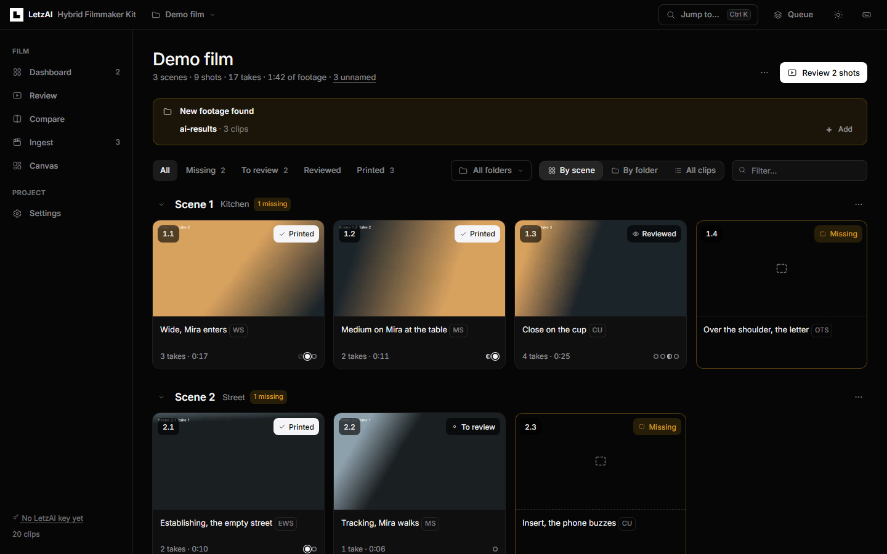
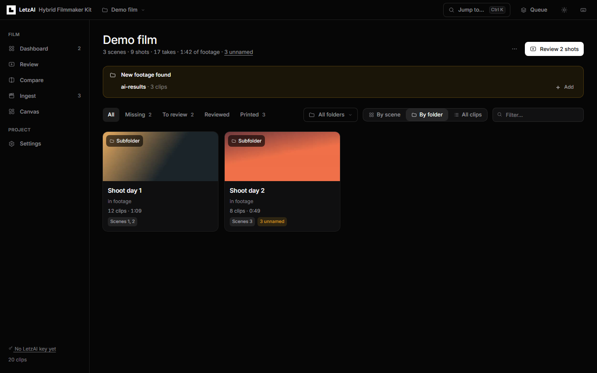
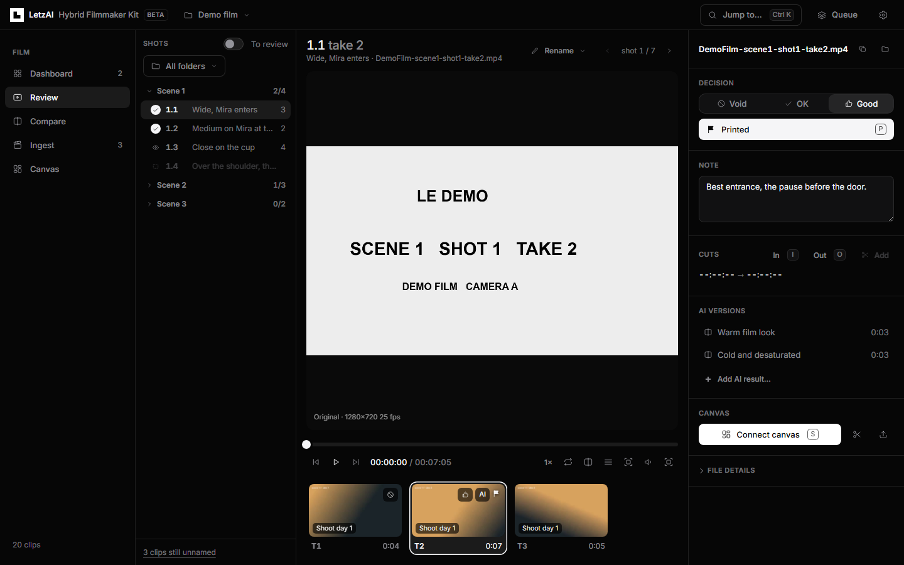
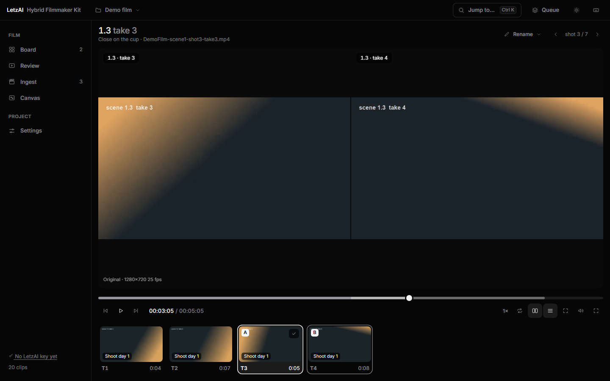
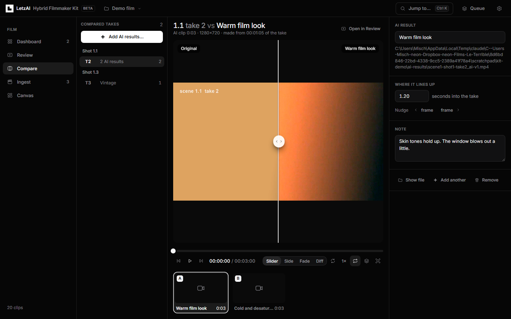
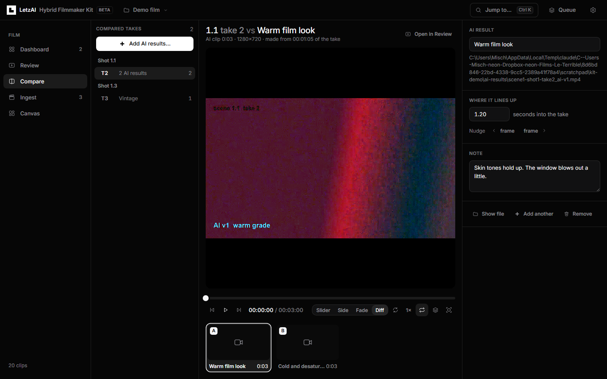
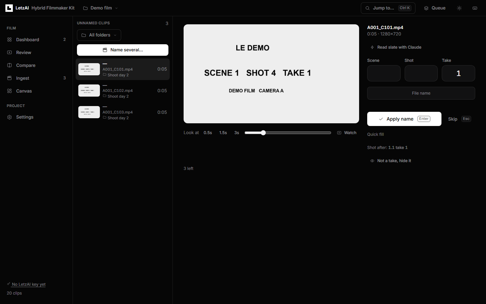
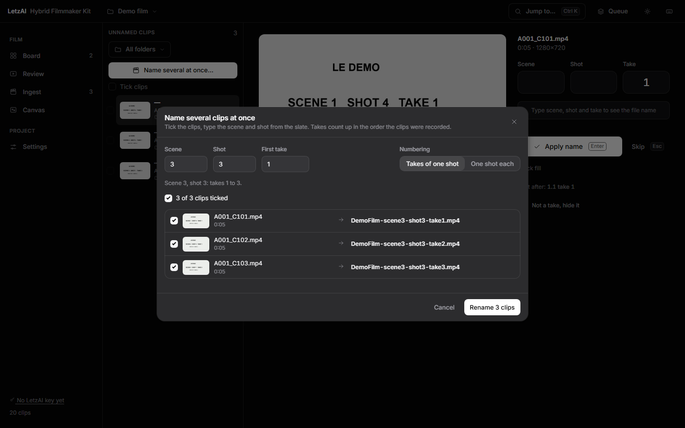
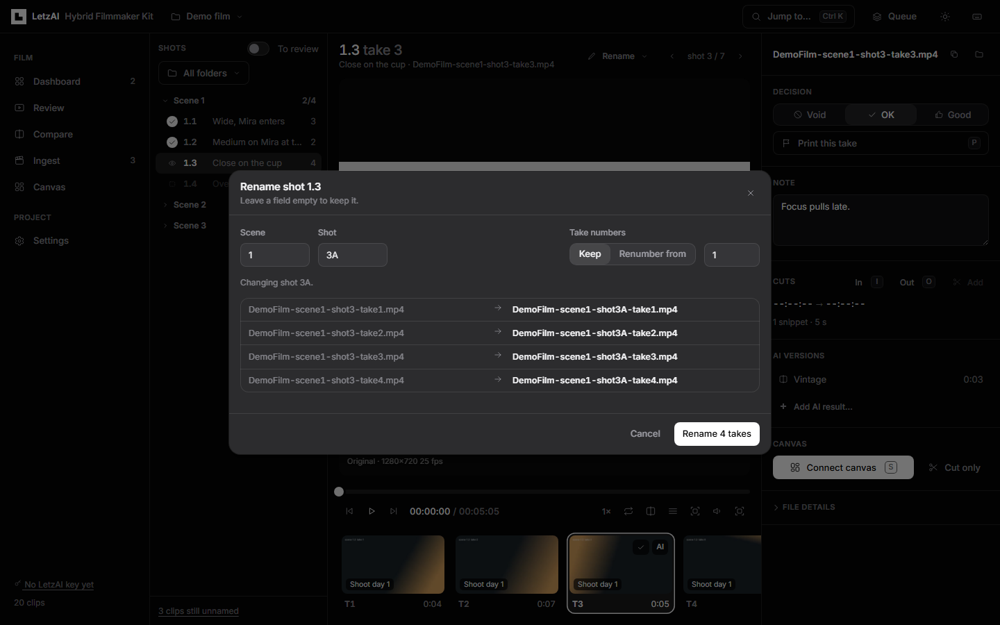
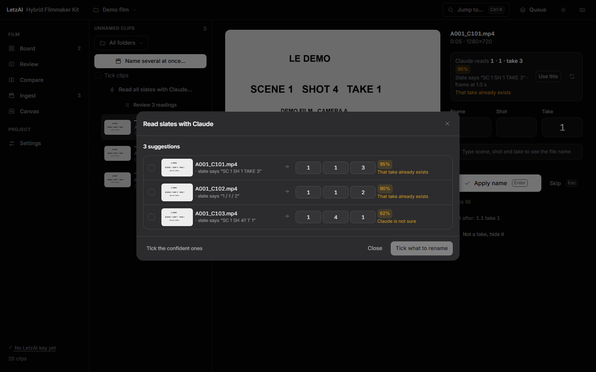

# LetzAI Hybrid Filmmaker Kit

[](https://github.com/Letz-AI/letzai-hybrid-filmmaker-toolkit/actions/workflows/ci.yml)
[](LICENSE)


**Review your footage, see which shots are still missing, name and pick your best takes, and send them to a [LetzAI Canvas](https://www.letz.ai/canvas).**

The kit runs on your own computer, with your own footage. It is free and open source. You don't need an account to review and name clips.

It is made for hybrid films: shoot real footage, sort it quickly, then bring the best takes into LetzAI and generate around them.



## Contents

[What it does](#what-it-does) · [Install](#install) · [First steps](#first-steps) · [A tour](#a-tour) · [AI slate reading](#ai-slate-reading) · [Shot list](#the-shot-list) · [Keyboard](#keyboard) · [File names](#file-names) · [LetzAI Canvas](#sending-to-a-letzai-canvas) · [4K and HEVC](#playing-4k-and-hevc-clips) · [Privacy](#your-data-and-privacy) · [Help](#when-something-goes-wrong) · [Development](#development)

## What it does

| | |
|---|---|
| **Dashboard** | Your shot list next to what you actually shot: every scene and shot with a thumbnail, number of takes and status. Missing shots stand out. |
| **Review** | A frame-accurate player for watching takes. Rate them, mark the one you want to use, write notes, set in and out points, and compare two takes side by side. Everything works from the keyboard. |
| **Ingest** | Give camera files proper names from the slate: type scene, shot and take, press Enter, next clip. Or name many clips at once. Every rename can be undone. |
| **AI slate reading** | Let Claude, ChatGPT or Gemini read the slates and suggest the names. You check them before anything is renamed. Uses your own API key. |
| **Rename** | Fix names later: one take, a whole shot, a whole scene, or any selection. |
| **Folders** | A film is often several shoot days. Show one folder at a time, and get told when new footage turns up. |
| **Compare** | Put an AI-generated version of a take next to the original: with a slider, side by side, as a cross-fade, or as a difference view. Both play in sync. |
| **Canvas** | Cut takes into short snippets (up to 30 seconds) and send them to your LetzAI Canvas, one page for everything or one page per scene. Nothing is sent twice, and failed uploads can be retried. |

## Install

You need **Node.js 20 or newer** and **ffmpeg**. Nothing else: there is no `npm install`, the kit has no dependencies.

### 1. Install Node.js and ffmpeg

Open a terminal (on Windows: PowerShell) and run the commands for your system.

<table>
<tr><th>Windows 10 / 11</th><th>macOS</th><th>Linux (Debian, Ubuntu)</th></tr>
<tr><td>

```powershell
winget install OpenJS.NodeJS.LTS
winget install Gyan.FFmpeg
```
Then close and reopen the terminal.

</td><td>

```bash
brew install node ffmpeg
```
No Homebrew? Get it at [brew.sh](https://brew.sh).

</td><td>

```bash
sudo apt update
sudo apt install ffmpeg git
```
For Node.js 20+ use [nodejs.org](https://nodejs.org/en/download): the version in Debian and Ubuntu is often too old.

</td></tr>
</table>

On other systems, install Node.js 20+ and ffmpeg from [nodejs.org](https://nodejs.org) and [ffmpeg.org](https://ffmpeg.org/download.html).

### 2. Download the kit

```bash
git clone https://github.com/Letz-AI/letzai-hybrid-filmmaker-toolkit.git
cd letzai-hybrid-filmmaker-toolkit
```

No git? On this page press **Code → Download ZIP**, unzip it, and open a terminal in that folder.

### 3. Check your setup

```bash
npm run check
```

This lists what was found and tells you what to install if something is missing.

### 4. Start it

```bash
npm start
```

The kit opens in its own window. Closing the terminal stops it.

Prefer double-clicking? Use **`Start-Kit.bat`** on Windows, **`Start-Kit.command`** on macOS (the first time: right-click, then Open), or **`start-kit.sh`** on Linux.

**Just want to look around?** Run `npm run demo`. It creates a small sample film with slates, takes, two shoot days and a shot list, and opens it.

### Updating and removing

Update with `git pull` (or download the ZIP again).

*Settings* has two parts: **This film** (name, file names, footage folders, playback) and **Kit** (keys, AI slate reading and budget, appearance, system). The Kit part works before you open a film: use the gear at the top right. To test from a clean start, *Settings → Account and keys → Start from scratch* removes your keys and settings from this computer.

To remove the kit, delete its folder. Your footage is not affected. Your settings and API keys are kept in a separate folder: `npm run check` shows where. Delete that too for a clean removal. Each film folder also has one small file, `letzai-kit.json`, with your ratings and notes.

### Windows, macOS and Linux

The kit is developed and used on Windows. macOS and Linux are covered by automated tests. If you hit a problem there, please [open an issue](https://github.com/Letz-AI/letzai-hybrid-filmmaker-toolkit/issues).

| | Windows | macOS | Linux |
|---|---|---|---|
| **Folder dialog** | built in | built in | needs `zenity` or `kdialog`, otherwise paste the folder path |
| **4K HEVC camera files** | play directly with the "HEVC Video Extensions" from the Microsoft Store, otherwise the kit makes small copies | play directly | the kit makes small copies |
| **Browser for the app window** | Edge, Chrome or Brave | Chrome, Edge, Brave or Safari | Chrome, Chromium, Edge, Brave or Firefox |

## First steps

The first time you start the kit, a short setup asks for two optional keys: your **LetzAI API key** (to send takes to a canvas) and a **Claude, ChatGPT or Gemini key** (to let an AI read slates). Skip either one and that feature stays switched off until you add the key later, in *Settings* or *Canvas*. Everything else works without keys.

1. **Choose your film folder.** The kit adds one small file to it, `letzai-kit.json`. Your footage is only renamed or cut when you ask for it.
2. **Name your clips** in *Ingest*. A camera file like `A001_C047.mov` becomes `YourFilm-scene6-shot2-take1.mov`. Subfolders and your camera's `Proxy` folder are found automatically.
3. **Write your shot list** (*Dashboard → ⋯ → Shot list…*), or start from what you have already shot. The Dashboard then shows what is missing.
4. **Review your takes.** Rate them with `1` `2` `3`, mark the one you want with `P`, and add notes. `Ctrl K` (`Cmd K` on a Mac) jumps to any shot.
5. **Connect LetzAI** in *Canvas*: paste your LetzAI API key, choose your canvas, tick takes and press *Cut and send*.

## A tour

### Dashboard

The Dashboard is the home screen. *By scene* shows each shot as a card, *By folder* shows your shoot days, and *All clips* is a list where you can tick takes. The folder button at the top shows only one folder.

The **⋯** menu at the top has the shot list, *Add scene…*, CSV reports, *Rename all files…* and *Copy printed takes*. Each scene has its own **⋯** menu with *Add shot…* and *Rename takes…*.



### Review

Step frame by frame (`←` `→`), change speed (`J` `K` `L`), set in and out points (`I` `O`), make cuts (`Enter`), add markers (`M`), rate (`1` `2` `3`) and mark the take you want (`P`). `C` compares two takes side by side, and `T` hides the side panels for a bigger picture.





### Compare: original vs AI

Made an AI version of a take? Put it next to the original and see what changed.

1. Open **Compare** and press **Add AI results…**. Choose video files, pick them from your LetzAI Canvas, or paste a link. The kit guesses which take each one belongs to from its file name; you can change that.
2. An AI video is usually made from one snippet of a take. Say which snippet, and both videos play in step. You can adjust the start frame by frame.
3. Compare them with **Slider**, **Side by side**, **Fade** or **Difference** (which highlights what changed). Several AI versions of one take appear in a strip below, so you can pick the best.





Removing an AI result only removes the link to the take; the video file stays where it is.

### Ingest: naming clips

Each clip without a name shows a large frame so you can read the slate. Click it to enlarge it; the buttons below jump further into the clip if the slate comes later. Type scene, shot and take, press `Enter`, and the next clip appears. The kit suggests the next take number, warns about duplicates, and `Ctrl Z` undoes a rename.



**Name several clips at once** with **Name several…** at the top of the list:

- **Type the slate.** Type the scene and shot once and set the first take. The takes count up in the order they were recorded (or choose *One shot each*). You see every new name before you press **Rename**.
- **Let the AI read the slates.** See [AI slate reading](#ai-slate-reading). Switch on *Also check clips that already have a name* to check names you gave earlier.

Existing names are never overwritten, and one **Undo** reverses the whole batch.



### Renaming takes that already have a name

- **Review → Rename ▾**: this take, the whole shot or the whole scene.
- **Dashboard → scene ⋯ → Rename takes…**
- **Dashboard → All clips**: tick takes, then **Rename selected…**

Change the scene or shot and, if you like, renumber the takes. You see every new name first.



To apply a new prefix or number style to every file, use **Dashboard → ⋯ → Rename all files…**.

## AI slate reading

Typing every slate by hand is the slow part. An AI can do the reading while you do the checking. Choose **Claude** (Anthropic), **ChatGPT** (OpenAI) or **Gemini** (Google), with your own API key from that company.

1. **Add a key.** In *Settings → AI slate reading*, choose the AI and paste your key, or start a reading and the dialog asks for it. Get a key from the [Anthropic Console](https://console.anthropic.com/settings/keys), the [OpenAI dashboard](https://platform.openai.com/api-keys) or [Google AI Studio](https://aistudio.google.com/apikey). The key is tested when you save it and stays on your computer.
2. **Choose the clips.** In *Ingest*, press *Name several…* and switch to *Claude reads the slates* (the button names the AI you chose), or use *Read slate with Claude* on a single clip. To check a take that already has a name: *Review → Rename ▾ → Check this name with Claude*.
3. **Confirm.** Before anything is sent, you see how many clips will be read and roughly what it will cost. You can pick the model and must agree that frames are sent to that company. About six frames from the start of each clip are sent (six more if no slate is found). File names are not sent.
4. **Check the results.** Each row shows the frame that was read (click to enlarge), what the slate says, the suggested scene, shot and take (you can edit them), and how sure the AI is. Rows are flagged when the take already exists, two clips were read as the same take, the scene isn't in your shot list, the numbers don't fit the recording order, or the AI isn't sure. Tick the ones you want and press **Rename**. One undo reverses it.



When a slate can't be read, the AI says so instead of guessing, and the clip is listed for you to check. Results are saved, so a clip is only read again when you ask for it, and you don't pay twice.

### What it costs

You pay the AI company directly, for what you use. A rough guide per clip with the recommended models: Gemini 3.8 Flash about $0.007, GPT-6.1 Terra about $0.01, Claude Sonnet 5.5 about $0.016. That is roughly $1.50 to $3 for a shoot day of 200 clips. The cheapest models cost a tenth of that, the most careful ones about twice as much.

- **Before each run** the kit shows the estimated price, and *Settings → AI slate reading* shows what you have spent this month.
- **Monthly budget.** Set one in *Settings → AI slate reading* (or in the setup). When it is used up, reading stops; clips read until then keep their results.
- **Large runs** above an amount you choose ($5 by default) ask for a second confirmation.
- These amounts are estimates based on list prices. For a hard limit, also set a spending limit in your Anthropic, OpenAI or Google account; the kit links to it.

## The shot list

Plain text, one shot per line. The preview next to it shows what the Dashboard will track.

```
Scene 6 - Kitchen
6.1  Wide, Mira enters  [WS]
6.2A Close on the cup   [CU]
?6.4 Optional insert        # a ? in front makes a shot optional
6.5-8                       # shots 5, 6, 7 and 8

Scene 7 - Street
7.1-3
```

Under a scene heading you can leave out the scene number (`2A  Close on the cup`). Even without a shot list, the Dashboard notices gaps in your numbering: with shots 1, 2 and 4, shot 3 is flagged.

## Keyboard

On a Mac, use `Cmd` instead of `Ctrl`.

| Anywhere | |
|---|---|
| `Ctrl K` | Jump to any shot, file or action |
| `g` then `d` `r` `m` `i` `c` `s` | Go to Dashboard, Review, Compare, Ingest, Canvas, Settings |
| `?` | All shortcuts |

| Review | | | |
|---|---|---|---|
| `Space` / `K` | play, pause | `1` `2` `3` | rate: void, ok, good |
| `J` / `L` | slower, faster | `P` | mark as the take to use |
| `←` `→` | one frame (`Shift`: one second) | `[` `]` | previous, next take |
| `I` `O` | in point, out point | `{` `}` | previous, next shot |
| `Enter` | add a cut from in to out | `C` | compare with the next take |
| `M` | marker | `T` | hide side panels |
| `S` | send to canvas | `F` | full screen |

| Compare | | | |
|---|---|---|---|
| `Space` | play, pause | `1` `2` `3` `4` | slider, side by side, fade, difference |
| `←` `→` | one frame | `S` | swap sides |
| `[` `]` | previous, next AI result | `{` `}` | previous, next take |
| `F` | full screen | | |

| Ingest | |
|---|---|
| `Enter` | apply the name, next clip |
| `Tab` | next field |
| `Esc` | skip |
| `Ctrl Z` | undo the last rename |

## File names

```
<Prefix>-scene<S>-shot<H>-take<T>.<ext>        MyFilm-scene6-shot2A-take3.mov
```

- The prefix and the number style (`6` or `06`) are set in *Settings → Film*.
- Ratings and notes are saved in the project file, so a file name never changes when you change your mind. If you'd like the rating in the name (`...-take3-good-print.mov`), switch it on in *Settings → Film*.
- Cut snippets go into a `cuts` folder next to the take (`...-take3-cut-1.mp4`). When you rename a take, its snippets and camera proxy are renamed with it.
- Renaming is safe: if anything goes wrong, all changes are put back, and every rename can be undone. A file that is briefly in use (for example by Dropbox) is tried again.

## Sending to a LetzAI Canvas

The kit uses the LetzAI API with your own key. Get a key at [letz.ai/subscription](https://letz.ai/subscription), paste it into *Settings → Account and keys* (or *Canvas*), then choose your canvas in *Canvas*.

- **One page or one page per scene.** On *one page*, each scene gets a heading. With *page per scene*, each scene goes to its own page (`Scene 6`, `Scene 14`, …). The LetzAI API cannot create pages, so if a scene has no page yet, the kit tells you which page to add.
- **What is uploaded.** Only the snippets you send, up to 30 seconds each, scaled down to 1080p by default.
- **Order.** Three clips per row, sorted by shot, take and cut, each with a caption. The kit only moves clips it added itself, never your own work.
- **No duplicates.** A snippet is never uploaded twice. If you cut a take again, the new snippet replaces the old one.
- **Failed uploads.** Every upload is checked. If one fails, the take shows the reason and a **Retry** button.

## Playing 4K and HEVC clips

Phones and many cameras record 4K HEVC (H.265), which most browsers can't play. The kit uses your camera's own proxy files when there are any. Otherwise it makes a small playable copy of each clip in the background. The top bar shows how many are left, and a click pauses or resumes. *Settings → Playback* turns this off.

For instant playback without copies: on Windows, install **HEVC Video Extensions** from the Microsoft Store. On macOS these files already play.

## Your data and privacy

| What | Where |
|---|---|
| Ratings, notes, cuts, markers, shot list, AI readings | `letzai-kit.json` in your film folder |
| Playable copies and thumbnails | your computer's cache folder (safe to delete) |
| LetzAI and AI API keys | your user settings folder, readable only by you, never in the film folder |

The kit only runs on your computer, and other websites can't access it. Nothing is uploaded except:

- the snippets you send to your LetzAI Canvas, and
- if you use AI slate reading, a few frames per clip, sent only to the AI company you chose.

API keys can also come from environment variables: `LETZAI_API_KEY`, `ANTHROPIC_API_KEY`, `OPENAI_API_KEY` and `GEMINI_API_KEY`.

## When something goes wrong

| | |
|---|---|
| **`npm run check` says ffmpeg is missing** | Install it (see [Install](#1-install-nodejs-and-ffmpeg)), reopen the terminal and check again. |
| **"Node.js 20 or newer is needed"** | Update Node.js from [nodejs.org](https://nodejs.org/en/download). |
| **A clip says "Preparing a playable copy"** | Your browser can't play that camera file directly. A small copy is being made, which takes 10 to 60 seconds. See [4K and HEVC](#playing-4k-and-hevc-clips). |
| **A rename says a file is in use** | Dropbox, OneDrive or another program is reading it. Nothing was changed. Wait until syncing has finished and try again. |
| **The AI key is not accepted, or there is no credit** | Check the key in *Settings → AI slate reading*. Most AI companies need some prepaid credit on the account. |
| **"Monthly budget used up"** | Raise the budget in *Settings → AI slate reading*, or wait until next month. |
| **A button is greyed out** | It needs a key you haven't added yet: the LetzAI key for anything with the canvas, an AI key for slate reading. *Settings → Account and keys* adds both. |
| **An upload failed** | Open *Canvas*: the take shows the reason, and *Retry* sends what is missing. "Scene N has no page" means you need to add a page with that name in LetzAI. |
| **It opens in a browser tab, not a window** | That's fine, it works the same. The kit uses your normal browser when it can't find Chrome, Edge or Brave. |
| **Port already in use** | `npm start -- --port 5000` |
| **The window looks outdated after an update** | Reload it with `Ctrl R`. |
| **Still stuck** | Run `npm run check` and [open an issue](https://github.com/Letz-AI/letzai-hybrid-filmmaker-toolkit/issues) with what it says. |

## Development

```bash
npm test        # all tests (the video tests need ffmpeg)
npm run dev     # restart the server when files change
npm run demo    # the sample film
npm run check   # is this computer ready?
```

Plain Node.js on the server (`server/`) and plain JavaScript modules in the interface (`ui/`), with no build step and no dependencies. The tests run on Windows, macOS and Linux on every push. The LetzAI and AI APIs are replaced by local stand-ins in the tests, so they never call the real services.

- [docs/ARCHITECTURE.md](docs/ARCHITECTURE.md): how it works
- [docs/ROADMAP.md](docs/ROADMAP.md): ideas for what's next
- [CONTRIBUTING.md](CONTRIBUTING.md): how to contribute
- [docs/BRANDING.md](docs/BRANDING.md): design and trademark notes

## Brand

The interface follows the [LetzAI brand guidelines](https://www.letz.ai/brandguidelines). The LetzAI **L** in the top bar uses the official files, unchanged.

## License

[MIT](LICENSE). The LetzAI name and logos are not covered by this license.
